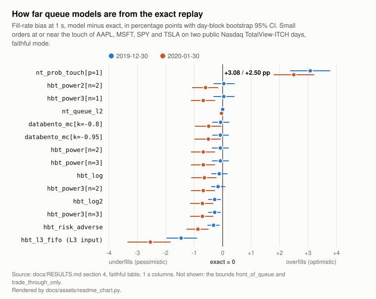

# queuetruth

[](https://pypi.org/project/queuetruth/)
[](https://pypi.org/project/queuetruth/)
[](https://github.com/sarptandoven/queuetruth/blob/main/LICENSE)

**Your backtest fills orders your live strategy never gets. queuetruth measures by how much, and why.**

A resting order fills only after everything ahead of it in the queue has traded or cancelled. Backtesters cannot see
that queue, so they guess. queuetruth replays order-level market data through an exact FIFO book, puts your orders
in the real queue and records when each one would really have filled. Against that answer it scores the fill models
of hftbacktest, NautilusTrader and Databento, fits their parameters, and scores your own simulator against your live
fills, order by order.

**[The Fill-Realism Atlas](https://sarptandoven.github.io/queuetruth/)**, rebuilt from free IEX DEEP+ data: over 20
trading days (2026-10-09 to 2026-11-06; 265,402 symbol-days, 12,440 symbols), the exact queue fills **11.97%** of
small resting orders within 1 minute. NautilusTrader's touch fill model fills **1.50 pp more** (13% more orders; 95%
interval +1.45 to +1.55 pp), NautilusTrader's `queue_position` model is closest at +0.06 pp, and hftbacktest's L3
FIFO model fills 1.82 pp fewer because of hftbacktest's own rules: it skips hidden executions and counts a
trade-through only through the feed's best price ([why](https://github.com/sarptandoven/queuetruth/blob/main/scripts/scale/findings/l3-fifo-gap.md)). IEX is one
venue with its own rules; [how the atlas is made](https://sarptandoven.github.io/queuetruth/docs/concepts/fill-realism-atlas/).

## See it in a minute

```sh
pipx run queuetruth demo --yes
```

This streams the first minutes of a public Nasdaq TotalView-ITCH day (about 315 MB, cached as a 7 MB subset), places
3,000 small resting orders in the real queue of AAPL, MSFT, SPY and TSLA, and prints the answer first:

```text
Within 1 s, NautilusTrader's default fill model fills 33.1% of these orders; the exact replay of the real queue
fills 29.4%: 3.6 pp (1.12x) too many (95% CI +2.6 to +4.8 pp).
```

followed by the table for every horizon and a self-contained HTML report. Nothing else is downloaded, and nothing is
sent anywhere: queuetruth has no telemetry. [Getting started](https://sarptandoven.github.io/queuetruth/docs/getting-started/)
walks through the same steps by hand.

<!-- Release step: pin this image URL to the release tag (.../queuetruth/vX.Y.Z/docs/assets/...) so the PyPI page and its chart cannot disagree. -->
[](https://sarptandoven.github.io/queuetruth/docs/RESULTS/#4-how-far-are-l2-queue-models-from-exact-truth-rd-8-extended-the-headline-experiment)

## What it found on real data

Two public Nasdaq ITCH days (2019-12-30, 2020-01-30), 3,000 small orders at or near the touch per day, every order
scored against the exact replay of the real queue:

- **NautilusTrader's default touch fill model overfills.** In the real engine (nautilus_trader 1.231.0; 2.0.0rc7
  fills the same orders) it fills 14.17% of orders within 1 s where the real queue fills 11.03%: **+3.13 pp**
  (95% CI +2.53 to +3.77; [the headline number](https://sarptandoven.github.io/queuetruth/docs/RESULTS/#the-headline-number));
  +2.80 pp on the second day. On deep-queue names (BAC, F, GE, SIRI, T, PFE) it reaches
  **+8.60 pp at 60 s**.
- **Calibration fixes it out of sample.** `p = 0.29`, fitted on day one, cuts day two's 1 s overfill from +2.8 pp to
  +0.4 pp. The export refuses any fit that does not beat the library default on held-out data.
- **hftbacktest's power and log models are close on liquid names**: within about 1 pp of exact at 1 s, 10 s and
  60 s. Its partial-fill exchange stops on this order flow (issue #312); with the fix queuetruth proposes, its fills
  equal queuetruth's faithful models on all 5,795 orders.

Two days, one venue, the most liquid US stocks: refit for your venue and feed. Every table, by horizon, queue
position and liquidity tier, plus 36 more symbols in five tiers:
[Results](https://sarptandoven.github.io/queuetruth/docs/RESULTS/).

## Pick your path

| You want to | Start here |
|---|---|
| know how wrong your backtester's fill model is | `queuetruth demo`, then [the model zoo on your data](https://sarptandoven.github.io/queuetruth/docs/concepts/l2-model-zoo/) |
| get a fitted parameter to paste into hftbacktest or NautilusTrader | [Calibrate my hftbacktest model](https://sarptandoven.github.io/queuetruth/docs/how-to/calibrate-hftbacktest/), [calibrate on an L2-only venue](https://sarptandoven.github.io/queuetruth/docs/how-to/calibrate-live-l2-venue/) |
| compare your backtest with your live fills | [Score my Nautilus backtest against my Binance fills](https://sarptandoven.github.io/queuetruth/docs/how-to/score-nautilus-vs-binance/), [reconcile Freqtrade or Hummingbot](https://sarptandoven.github.io/queuetruth/docs/how-to/reconcile-freqtrade-hummingbot/) |
| regression-test your own simulator's queue logic | [Referee my simulator](https://sarptandoven.github.io/queuetruth/docs/how-to/referee-your-simulator/) |
| prove a backtest result to someone else | [Certify a result](https://sarptandoven.github.io/queuetruth/docs/how-to/certify-a-result/) |
| let an AI agent trade a replayed day with exact fills | [Agent sandbox](https://sarptandoven.github.io/queuetruth/docs/how-to/agent-sandbox/), [use from an agent (MCP)](https://sarptandoven.github.io/queuetruth/docs/how-to/use-from-an-agent/) |
| make markets on Kalshi or Polymarket, or score forecasts | [Prediction-market making](https://sarptandoven.github.io/queuetruth/docs/how-to/prediction-market-making/), [score forecasts](https://sarptandoven.github.io/queuetruth/docs/how-to/score-forecasts/) |

Every term (shadow, zoo, exact arm, faithful and corrected) is in the
[Glossary](https://sarptandoven.github.io/queuetruth/docs/concepts/glossary/).

## Bring your data

| You have | You get | Read it with |
|---|---|---|
| Order-level data: Nasdaq TotalView-ITCH 5.0, IEX DEEP+ (free), NYSE TAQ Integrated Feed, Databento DBN MBO, Coinbase `level3`, Kraken L3, Hyperliquid node, Bitstamp, Bitfinex | exact replay, shadow orders, the zoo, calibration | `queuetruth ingest --format itch \| iex-deep-plus \| nyse-ibf \| dbn \| ...` |
| An L2-only tape (Tardis `incremental_book_L2` and trades) | the queue models, markouts and a parameter fitted to your fills; never exact truth | `ingest --format tardis-l2` |
| Your live orders and fills: Binance, Bybit, OKX, Coinbase, Kraken, Deribit, Hyperliquid, IBKR Flex, FIX 4.4 drop copies, QuickFIX logs | the sim-vs-live scorecard, `calibrate-live`, a latency fit | `queuetruth live import --venue <venue>` |
| Your backtest's output: hftbacktest or NautilusTrader | your simulator scored order by order against your live fills | `live import --venue sim-hftbacktest` or `sim-nautilus`, then `score --sim-log` |
| A Freqtrade backtest or dry run, or a Hummingbot paper bot, next to the bot's live run | each order paired with its twin, why it differs, and the scorecard | `queuetruth reconcile --kind freqtrade` or `hummingbot` |
| A Backtrader or VectorBT backtest (an analyzer's JSON lines, or `records_readable` CSV / JSON) and your live log | the same per-order account, and the backtest scored against live or exact queues | `queuetruth reconcile --kind backtrader` or `vectorbt`; `live import --venue sim-backtrader` or `sim-vectorbt` |
| A QuantConnect LEAN backtest (the result JSON and its order-events JSON) and your live log | the same per-order account and scorecard | `queuetruth reconcile --kind lean`; `live import --venue sim-lean` |

queuetruth ships no market data and fetches none except `demo`'s public sample day, after you agree. You need a
licence for the data you process: [Data and licensing](https://sarptandoven.github.io/queuetruth/docs/data-and-licensing/).

## Why the answer is exact

- **The book is right.** Over 16,754,562 records of the two public days, read from the raw ITCH bytes by
  queuetruth's own reader: 0 invariant violations, 0 trade-parity mismatches over 633,287 printed executions.
- **The fill rule is right.** An independent matching-engine oracle agrees with the exact fill rule on 3,000 of
  3,000 shadow orders on both days; 3,000 real orders per day used as a "live" log are reproduced exactly.
- **The replicas are faithful.** queuetruth's NautilusTrader models fill the same orders as nautilus_trader 1.231.0
  on 100% of orders at 1 s, 10 s and 60 s; its hftbacktest models are bit-exact against a transliteration of
  hftbacktest's source.
- **You can rerun all of it.** `make reproduce` streams the public day files and rebuilds every published number
  from the raw bytes. `queuetruth certify` and `verify-cert --rerun` re-execute a result bit for bit.

What each check covers and what is not tested yet:
[How queuetruth is tested](https://sarptandoven.github.io/queuetruth/docs/testing/).

## Status

<!-- validated:start -->

| Area | Status |
|---|---|
| Nasdaq TotalView-ITCH: exact book, shadow orders and scorer on 2 public days | Validated on real data |
| IEX DEEP+: exact book on 22 public days, in the atlas | Validated on real data |
| Calibration and the learned fill model, scored on a held-out Nasdaq day | Validated on real data |
| NautilusTrader fill models, against the real engine | Checked against the library |
| hftbacktest queue models, against a transliteration of its source | Checked against the library |
| Databento's queue-position model, from its public tutorial only | From public documentation only |
| Databento DBN and CME semantics | Fixtures and synthetic data only |
| Crypto order-level readers (Coinbase, Kraken, Hyperliquid, Bitstamp, Bitfinex) | Fixtures and synthetic data only |
| NYSE TAQ Integrated Feed reader | Fixtures and synthetic data only |
| Trading-halt spans from DBN and NYSE status records | Fixtures and synthetic data only |
| Every live-log importer, and the backtest importers and `reconcile` | Fixtures and synthetic data only |
| The prediction-market kit | Fixtures and synthetic data only |
| The forecast referee | Fixtures and synthetic data only |

Details and evidence for every row: [What is validated](https://sarptandoven.github.io/queuetruth/docs/validated/).

<!-- validated:end -->

Exact truth covers displayed liquidity on FIFO venues; shadows are censored during trading halts (recorded from
ITCH, IEX DEEP+, DBN and NYSE feeds). It does not model your own order's impact on others, hidden or iceberg
liquidity, auctions or pro-rata matching. queuetruth is not a backtester, OMS or trading system.

## Install

```sh
pip install queuetruth                 # CLI + Python API (abi3 wheels: macOS arm64/x86_64, Linux x86_64/aarch64)
pip install 'queuetruth[client]'       # + HTTP client for a self-hosted service
pip install 'queuetruth[mcp]'          # + MCP server for agents
```

CPython 3.11 or later. Other platforms build from source with Rust 1.88 or later. `queuetruth-core`, a standalone
binary for the native commands, is attached to each GitHub release. Interfaces: CLI, Python API, self-contained
HTML reports, a self-hostable HTTP service and an MCP server, all sharing published JSON Schemas.

The whole workflow on a synthetic dataset generated on your machine (no download; it shows the steps, not a result
about markets):

```sh
queuetruth fixtures synth --out synth
queuetruth shadows sample --data synth --n 1000 --out shadows.parquet
queuetruth zoo --data synth --shadows shadows.parquet --out zoo
```

The same from Python:

```python
import queuetruth as qt

z = qt.run_zoo({"dataset": {"path": "synth"}, "shadows": {"path": "shadows.parquet"}, "out": "zoo"})
for row in z.leaderboard:  # fill-rate bias vs exact at 60 s, with its 95% CI
    b = row.fill_rate_bias["60000000000"]
    print(f"{row.model_id:50s} {100 * b.value:+.2f} pp [{100 * b.ci_lo:+.2f}, {100 * b.ci_hi:+.2f}]")
```

## Development

```sh
uv venv .venv && make sync develop   # venv, locked dependencies, editable build of queuetruth._core
make test                            # lint + Rust + Python + service tests
make reproduce                       # every published real-data number from the public Nasdaq files
```

[Documentation](https://sarptandoven.github.io/queuetruth/docs/) ·
[CONTRIBUTING.md](https://github.com/sarptandoven/queuetruth/blob/main/CONTRIBUTING.md) ·
[SECURITY.md](https://github.com/sarptandoven/queuetruth/blob/main/SECURITY.md) ·
[Roadmap](https://github.com/sarptandoven/queuetruth/blob/main/ROADMAP.md) ·
[Design specification](https://sarptandoven.github.io/queuetruth/docs/design/spec/) ·
[Changelog](https://github.com/sarptandoven/queuetruth/blob/main/CHANGELOG.md)

## Licence

Apache-2.0, Copyright 2026 Sarp Tandoven. Queue-model logic ported from hftbacktest (MIT, credited in `NOTICE`).
NautilusTrader behaviours are re-implemented from its public documentation and checked against its released package
by calling its public API; no NautilusTrader code is included. Databento's queue-position estimator is
re-implemented from its documented behaviour.
