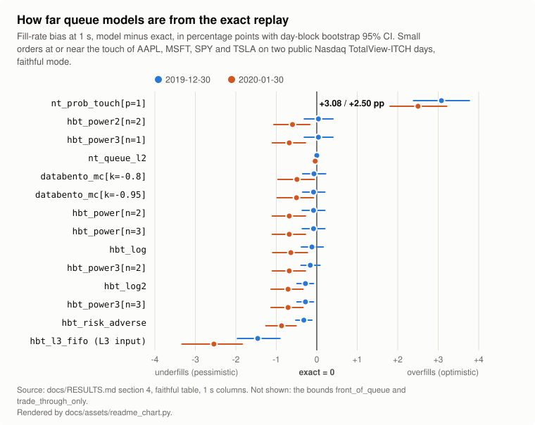

# queuetruth

**Your backtest fills orders your live strategy never gets. queuetruth measures by how much, and why.**

A passive order fills only after everything ahead of it in the queue has traded or cancelled. Backtesters that see
L2 data (sizes per price level) cannot know where you were in that queue, so they guess, usually with a probability
model of which cancels were ahead of you. queuetruth replays order-level (MBO) data through an exact FIFO book,
places shadow orders in the real queue and records when each one would have filled. It then runs the L2 queue models
people use (hftbacktest's, ported from its source; NautilusTrader's, re-implemented and checked order by order
against the real engine; Databento's, re-implemented from its tutorial) on an L2 view of the same data, reports how far
each one is from the exact answer, fits their parameters against it, and scores your simulator against your own live
fills, order by order.

On two public Nasdaq TotalView-ITCH days (AAPL, MSFT, SPY, TSLA), NautilusTrader's touch fill model with the default
`prob_fill_on_limit = 1`, run in the real engine (nautilus_trader 1.231.0, `BacktestEngine` fed the L2 view as
`OrderBookDelta`s; the same orders fill on 2.0.0rc7), fills 14.17% of 3,000 small orders at or near the touch within 1
s where the exact replay fills 11.03% (+3.13 pp, 95% CI [+2.53, +3.77], 2019-12-30; +2.80 pp on 2020-01-30).
queuetruth's faithful NautilusTrader models agree with that engine on 100% of orders at 1 s, 10 s and 60 s. Refitting
`p` on the first day (`p = 0.29`) cuts the held-out next day's 1 s overfill from +2.8 pp to +0.4 pp (`p` is per print,
so refit it per venue and feed). The hftbacktest power and log models stay within about 1 pp of exact on these liquid
names, and `hbt_risk_adverse` is pessimistic by up to 1.3 pp. On 36 more Nasdaq names in five liquidity tiers the
NautilusTrader default overfills most on deep-queue names (+8.60 pp at 60 s on day one), while hftbacktest's
`power3[n=2]` stays within 1.7 pp (a 0.1.0 run, in which each hftbacktest model leaves out only its own #312 aborts).
The full tables, with intervals by horizon, queue decile, liquidity and tier: [Results](RESULTS.md).

The chart is drawn from the faithful-mode table of [Results](RESULTS.md) section 4 by `docs/assets/readme_chart.py`
(`--check` fails when the table and the chart disagree). Every model in it is scored on the same orders, 2,529 and
2,518 of the 3,000 a day: the orders on which a faithful hftbacktest model hit its bug #312 are left out of every
model, so the chart shows the NautilusTrader touch model at +3.08 and +2.50 pp rather than the +3.13 and +2.80 pp
measured on all 3,000. New to the vocabulary (shadow, zoo, exact arm, faithful and corrected, bounds, self-exclusion)?
Every term is defined in the [Glossary](concepts/glossary.md).

## Pick your path

| If you... | Start here |
|---|---|
| want to see the whole workflow on synthetic data in a few minutes | [Getting started](getting-started.md) |
| have order-level data and want to know how wrong your L2 model is | [The L2 model zoo](concepts/l2-model-zoo.md) |
| use hftbacktest and want a fitted `n` | [Calibrate my hftbacktest model](how-to/calibrate-hftbacktest.md) |
| trade an L2-only venue and want a parameter fitted to your own fills | [Calibrate on an L2-only venue](how-to/calibrate-live-l2-venue.md) |
| want to compare your backtest with your live fills | [Score my Nautilus backtest against my Binance fills](how-to/score-nautilus-vs-binance.md) |
| run a QuickFIX order-entry session and want to score your simulator against it | [Score my QuickFIX-driven strategy](how-to/score-quickfix-strategy.md) |
| maintain a simulator and want regression tests for queue logic | [Referee my simulator](how-to/referee-your-simulator.md) |
| want a shared service for a team or for agents | [Self-host the service](how-to/self-host-the-service.md) |
| want a word defined | [Glossary](concepts/glossary.md) |

## What it is

- **Exact replay**: Nasdaq TotalView-ITCH 5.0, Databento DBN MBO and crypto L3 captures through a per-instrument FIFO
  book with invariant counters, a queue-rank oracle and parity checks against the source's prints.
  [Exact FIFO truth](concepts/exact-truth.md)
- **Shadow orders**: "if I had joined the bid at 10:31:05.120 for 200 shares, when would I have filled?" Per-fill
  timeline, queue-ahead trajectory, latency, cancels and priority-keeping amends. [Shadow orders](concepts/shadow-orders.md)
- **Queue-model zoo**: 14 queue-model configurations plus 2 bounds, each in a `faithful` mode (each library's
  behaviour as implemented, quirks included: bit for bit for hftbacktest; re-implemented for NautilusTrader and
  checked against nautilus_trader 1.231.0 order by order; re-implemented from its tutorial for Databento) and a
  `corrected` mode, scored against exact truth by horizon, queue position and
  liquidity. [The L2 model zoo](concepts/l2-model-zoo.md)
- **Calibration and export**: `n` (hftbacktest power models), `k` (Databento) and `p` (NautilusTrader
  `prob_fill_on_limit`) fitted on one window and scored on another, printed as a block to paste into your config.
  [Calibration](concepts/calibration.md)
- **A learned fill model**: a competing-risk hazard model trained on L2 features with exact labels.
  [The learned fill model](concepts/learned-model.md)
- **Sim-vs-live scorer**: your live order log replayed as a fixed schedule through your simulator, the exact engine
  or any zoo model, with a per-order 2x2 table, cluster-robust discordance tests, time to fill and markouts.
  [Scorecard statistics](concepts/scorecard.md)
- **Referee**: an exact-FIFO regression oracle for other simulators, with 16 bug-class fixtures.
- **Interfaces**: Python API, CLI, a self-contained HTML report, a self-hostable HTTP service and an MCP server for
  agents, all sharing the same JSON Schemas. [Reference](reference/cli.md)

## What it is not

Not a backtester, no strategy code, no order routing, no market data included. Shadows never take liquidity from real
orders or change anyone's behaviour (see [what a shadow does not do](concepts/shadow-orders.md#what-a-shadow-does-not-do)).
Exact truth covers displayed liquidity on FIFO venues; L2-only data supports the models and markouts, never exact
truth.

## How far to trust it

| Area | Status in v0.1 |
|---|---|
| Book and shadows on Nasdaq ITCH | validated on 2 public days from the raw ITCH bytes: 0 invariant violations over 16,754,562 records; the earlier private prototype's 3,000 mirror shadows per day reproduced exactly under its fill rule. An independent matching-engine oracle agrees on 3,000 of 3,000 shadows on both days from the raw ITCH bytes (queuetruth's mirror sampler) and on 2,997 and 3,000 of 3,000 on the prototype's CSV conversion with its mirror shadows (the 3: the oracle's 1 s cross window on a CSV without cross flags) |
| NautilusTrader models | faithful `nt_prob_touch`, `nt_queue_l2` and `nt_queue_l2_prob_touch` agree with nautilus_trader 1.231.0's `BacktestEngine` on an `OrderBookDelta` feed on 100% of orders at 1 s, 10 s and 60 s on both Nasdaq days and the synthetic fixture (`nt_queue_l2_prob_touch` at `p = 1`; at `p = 0.29` Nautilus draws fills at random, and its realised rates are within 0.5 pp of the zoo's expected rates on both days). They describe 1.231.0 on delta feeds: fed `OrderBookDepth10` snapshots, 1.231.0 resets queue position at every snapshot and its queue model fills like the touch model, while the 2.0 release candidates from rc5 keep it, so their depth feed fills like the delta feed. On 2.0.0rc7 the touch model fills the same orders as on 1.231.0 and `nt_queue_l2` agrees on 99.60% to 100% of orders per day and horizon (2.0 caps queue ahead when a level shrinks) |
| Databento model | re-implemented from the public tutorial; not checked against Databento's own code |
| hftbacktest faithful models | bit-exact against a line-by-line transliteration of its source (O-ZOO-2); the transliteration matches hftbacktest 2.4.4 on every recorded queue-model call |
| DBN / CME | synthetic only |
| Crypto L3 readers | assumed rules; one 10-minute capture per venue replays with every invariant 0 (counters only, not fill fidelity) |
| Live-log importers, QuickFIX logs | fixtures written from public format docs and the engines' sources only |
| Sim-vs-live scorer | 3,000 real Nasdaq orders per day used as a live log: the exact arm reproduces every order's fills on both days |

Every claim has a named test: [How queuetruth is tested](testing.md). The rules that changed after an independent
audit are on [Rules from the independent audit](concepts/audit-rules.md). What you may do with vendor data is on
[Data and licensing](data-and-licensing.md).
