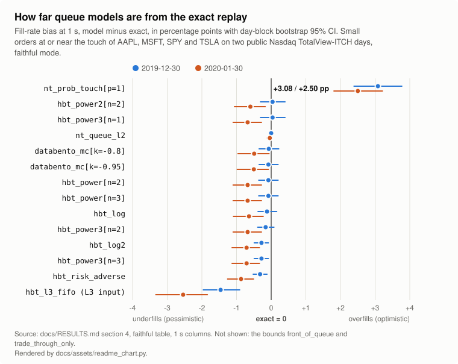

# queuetruth

**Your backtest fills orders your live strategy never gets. queuetruth measures by how much, and why.**

A resting order fills only after everything ahead of it in the queue has traded or cancelled. Backtesters cannot see
that queue, so they guess. queuetruth replays order-level market data through an exact FIFO book, puts your orders
in the real queue and records when each one would really have filled. Against that answer it scores the fill models
of hftbacktest, NautilusTrader and Databento, fits their parameters, and scores your own simulator against your live
fills, order by order. These docs are published at
[sarptandoven.github.io/queuetruth/docs](https://sarptandoven.github.io/queuetruth/docs/), next to the atlas.

**[The Fill-Realism Atlas](https://sarptandoven.github.io/queuetruth/)**, rebuilt from free IEX DEEP+ data: over 20
trading days (2026-10-09 to 2026-11-06; 265,402 symbol-days, 12,440 symbols), the exact queue fills **11.97%** of
small resting orders within 1 minute. NautilusTrader's touch fill model fills **1.50 pp more** (13% more orders; 95%
interval +1.45 to +1.55 pp), NautilusTrader's `queue_position` model is closest at +0.06 pp, and hftbacktest's L3
FIFO model fills 1.82 pp fewer because of hftbacktest's own rules: it skips hidden executions and counts a
trade-through only through the feed's best price ([why](https://github.com/sarptandoven/queuetruth/blob/main/scripts/scale/findings/l3-fifo-gap.md)). IEX is one
venue with its own rules: [how the atlas is made](concepts/fill-realism-atlas.md).

## Three ways in

| | |
|---|---|
| **[See it in a minute](tutorials/see-it-in-a-minute.md)** | `queuetruth demo` on a public Nasdaq day: how often NautilusTrader's default fill model fills small resting orders, against the exact replay of the real queue. No data of your own needed. |
| **[Read the atlas](concepts/fill-realism-atlas.md)** | How far each popular fill model is from the real queue, by liquidity tier, in fill rate and in P&L, and which setting comes closest. |
| **[Check my backtester](#check-my-backtester)** | One guide per framework: hftbacktest, NautilusTrader, Freqtrade and Hummingbot, Backtrader, VectorBT and LEAN, or your own simulator. |

## Check my backtester

| You use | Start here |
|---|---|
| hftbacktest | [Score and calibrate my hftbacktest backtest](how-to/calibrate-hftbacktest.md) |
| NautilusTrader | [Check and calibrate my NautilusTrader backtest](how-to/nautilustrader.md) |
| Freqtrade or Hummingbot | [Reconcile Freqtrade and Hummingbot runs](how-to/reconcile-freqtrade-hummingbot.md) |
| Backtrader, VectorBT or QuantConnect LEAN | [Reconcile a Backtrader, VectorBT or LEAN backtest](how-to/reconcile-backtrader-vectorbt.md) |
| any simulator, against your live fills | [Decompose the sim-live gap](how-to/decompose-the-sim-live-gap.md), [score a QuickFIX-driven strategy](how-to/score-quickfix-strategy.md) |
| your own simulator, in CI | [Referee my simulator](how-to/referee-your-simulator.md) |

## The headline result on Nasdaq

On two public Nasdaq TotalView-ITCH days, NautilusTrader's default touch fill model, run in the real engine, fills
14.17% of 3,000 small orders within 1 s where the exact replay fills 11.03%: **+3.13 pp** (95% CI +2.53 to +3.77;
population and method in [the headline number](RESULTS.md#the-headline-number)). Refitting its fill probability on
one day (`p = 0.29`) cuts the next day's 1 s overfill from +2.8 pp to +0.4 pp. The hftbacktest power and log models
stay within about 1 pp of exact on these liquid names. Every table: [Results](RESULTS.md).

The chart is drawn from the faithful-mode table of [Results](RESULTS.md) section 4 by `docs/assets/readme_chart.py`.
Every model in it is scored on the same orders, 2,529 and 2,518 of the 3,000 a day (orders on which a faithful
hftbacktest model hits its bug #312 are left out of every model), so it shows the NautilusTrader touch model at +3.08
and +2.50 pp rather than the +3.13 and +2.80 pp measured on all 3,000.

## More

- **Learn it step by step:** [Your first leaderboard](getting-started.md) on synthetic data, then
  [a real day from free IEX data](how-to/iex-public-demo.md).
- **Bring your data:** [import fills from your venue or broker](how-to/import-live-logs.md),
  [check a feed](how-to/check-a-feed.md), [Databento MBO](how-to/databento-mbo.md),
  [NYSE](how-to/nyse-order-level.md), [crypto order-level feeds](how-to/crypto-l3-sources.md), and
  [what you may do with vendor data](data-and-licensing.md).
- **Prove it:** [certify a result](how-to/certify-a-result.md), [explain one fill](how-to/explain-one-fill.md).
- **Automate:** [agents (MCP and the sandbox)](how-to/use-from-an-agent.md), [notebooks](how-to/notebooks.md),
  [self-host the service](how-to/self-host-the-service.md).
- **Understand it:** [exact FIFO truth](concepts/exact-truth.md), [shadow orders](concepts/shadow-orders.md),
  [the L2 model zoo](concepts/l2-model-zoo.md), and the [glossary](concepts/glossary.md) for every term.

## What it is not

Not a backtester, no strategy code, no order routing, no market data included. Shadows never take liquidity from real
orders or change anyone's behaviour (see [what a shadow does not do](concepts/shadow-orders.md#what-a-shadow-does-not-do)).
Exact truth covers displayed liquidity on FIFO venues; L2-only data supports the models and markouts, never exact
truth.

## How far to trust it

One generated table says what is validated, on which data, and what is tested on fixtures only:
[What is validated](validated.md). How each check runs: [How queuetruth is tested](testing.md). The rules that changed
after an independent audit: [Rules from the independent audit](concepts/audit-rules.md).
